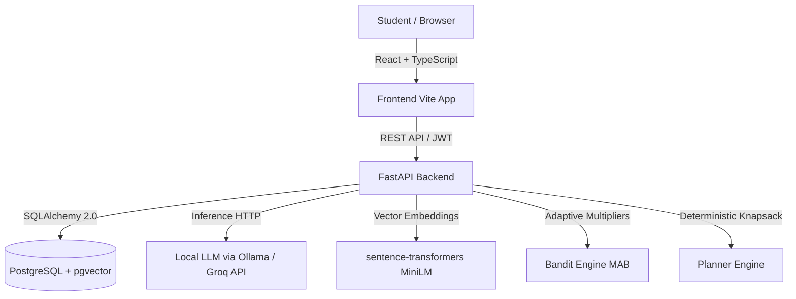

# TaskPilot — Project Context & Master Specification

> **TaskPilot** is an AI-powered student productivity and study planning assistant that transforms unstructured course requirements and student conversations into realistic, adaptive study schedules.

---

## 1. Project Overview & Vision

University students frequently struggle with:
1. Estimating how long academic assignments actually take.
2. Breaking broad syllabi and deadlines into concrete revision blocks.
3. Keeping schedules realistic when unexpected delays occur.

**TaskPilot solves this through four integrated pillars:**
- **Conversational Task Extraction:** An LLM fine-tuned to parse natural language student messages (in French, English, or mixed language) into structured task objects with strict JSON validation.
- **Adaptive Duration Calibration (Multi-Armed Bandit):** A reinforcement learning algorithm ($\varepsilon$-greedy bandit) that learns each student's personal estimation bias per academic subject over time.
- **Deadline-Constrained Scheduling:** A deterministic planner that packs tasks into available study hours without exceeding daily limits or missing deadlines.
- **Course Document RAG:** A Retrieval-Augmented Generation pipeline (PostgreSQL `pgvector` + `sentence-transformers`) enabling students to query uploaded PDFs (syllabi, course slides, assignment sheets).

---

## 2. System Architecture & Tech Stack



### Technology Breakdown

| Component | Technology | Rationale / Specification |
| :--- | :--- | :--- |
| **Backend Framework** | **FastAPI** (Python 3.11+) | Asynchronous, typed endpoints with native OpenAPI docs and high throughput. |
| **Database** | **PostgreSQL 16 + pgvector** | Relational integrity for user data + native vector similarity search for RAG. |
| **ORM & Migrations** | **SQLAlchemy 2.0** (`Mapped[...]`) | Modern typed declarative ORM with strict schema typing. |
| **Validation** | **Pydantic v2** & `pydantic-settings` | Server-side validation and `.env` configuration loading. |
| **Authentication** | **PyJWT** (HS256) + **bcrypt** | Stateless bearer token auth with purpose claims (`login`, `reset`). |
| **LLM Inference** | **Ollama** (Local) / **Groq** (Prototyping) | Fast token generation with strict JSON mode output. |
| **Fine-Tuning** | **Unsloth + TRL** (Colab T4 / Kaggle) | QLoRA 4-bit fine-tuning of `Qwen2.5-3B-Instruct` or `Llama-3.2-3B`. |
| **Embeddings & RAG** | `paraphrase-multilingual-MiniLM-L12-v2` | 384-dimensional multilingual embeddings, CPU-friendly, paired with `pypdf`. |
| **Frontend** | **React 18 + TypeScript + Vite** | Fast SPA, strictly typed, responsive mobile-friendly UI, custom CSS design system. |
| **Containerization** | **Docker & Docker Compose** | Reproducible local Postgres + pgvector setup. |

---

## 3. Team Division & Ownership

| Track | Owner | Core Responsibilities |
| :--- | :--- | :--- |
| **Track A: Backend & Core Engineering** | **You** | • Database schemas (`models.py`) & Database sessions (`session.py`)<br>• Core configuration & Security (`config.py`, `security.py`, `deps.py`)<br>• User Authentication & Multi-tenant data isolation<br>• Tasks CRUD API<br>• Deterministic Planner engine (`planner.py`) & unit tests<br>• Multi-Armed Bandit algorithm & updates (`bandit.py`)<br>• RAG ingestion & retrieval endpoints (`rag.py`, `documents.py`)<br>• Dashboard metrics API |
| **Track B: Machine Learning & Frontend** | **Teammate** | • System prompt specification & evaluation set curation<br>• Synthetic dataset generator script (`generate_data.py`)<br>• 800–1,500 sample chat dataset (FR, EN, mixed)<br>• Colab QLoRA fine-tuning with Unsloth<br>• Evaluation report & GGUF export to Ollama<br>• React UI development (Login, Dashboard, Tasks, Planning, Chat) |

---

## 4. The Shared Contract

Both the backend and ML tracks **strictly adhere** to this contract. Neither track may alter these field names without synchronizing with the other.

### A. Task Data Fields

```typescript
interface TaskContract {
  id?: number;
  title: string;             // max 200 chars
  description?: string;      // optional text details
  subject?: string;          // e.g. "Math", "Operating Systems", "Physics"
  priority: number;          // integer 1 (Low), 2 (Medium), 3 (High)
  due_date: string | null;   // YYYY-MM-DD or null
  estimated_minutes: number; // 5 to 1440 minutes (default 60)
  actual_minutes?: number;   // logged upon completion
  bandit_arm?: number;       // index of bandit arm applied (0 to 4)
}
```

### B. LLM Output Contract (JSON Mode)

The model must **always** return valid JSON conforming to:

```json
{
  "reply": "User-facing conversational response in the requested language.",
  "actions": [
    {
      "type": "create_task",
      "task": {
        "title": "Complete Networks Lab Report",
        "description": "Submit packet capture analysis",
        "subject": "Networks",
        "priority": 3,
        "due_date": "2026-11-20",
        "estimated_minutes": 360
      }
    }
  ]
}
```

#### Strict Operational Rules:
1. **Never Invent Deadlines:** If the student message lacks a deadline, `due_date` must be `null` and the `reply` should ask the student for the date.
2. **Never Auto-Commit:** Chat routes return task proposals to the frontend. Tasks are only persisted when the student clicks "Add this task" (POST `/tasks`).
3. **No Actions for Chitchat:** Casual inquiries or conceptual questions return an empty `actions: []` array.

---

## 5. Key Algorithms

### 1. Deterministic Study Planner (`services/planner.py`)
- **Input:** Uncompleted tasks and daily student availability `{ "YYYY-MM-DD": minutes }`.
- **Sorting:** Sorted primary by `due_date` ascending, secondary by `priority` descending.
- **Allocation:** Iterates over days until the task's deadline. Places `min(time_left_today, remaining_task_time)` per day. Discards slots $< 30$ minutes unless they conclude the task.
- **Output:** Scheduled calendar blocks, list of unassigned task IDs (tasks that do not fit before deadline), and warnings.

### 2. Multi-Armed Bandit Duration Calibration (`services/bandit.py`)
- **Multiplier Arms:** `[0.8, 1.0, 1.25, 1.5, 2.0]`
- **Policy:** $\varepsilon$-greedy ($\varepsilon = 0.10$). $90\%$ of the time, choose the arm with highest historical mean reward for `(user_id, subject)`. $10\%$ random exploration.
- **Reward Function:** $R = -| \text{ArmMultiplier} - \frac{\text{ActualMinutes}}{\text{EstimatedMinutes}} |$
- **Incremental Mean Update:** $\mu_{n} = \mu_{n-1} + \frac{R - \mu_{n-1}}{n}$

---

## 6. Multi-Tenant Data Isolation Rules

- **Zero Cross-User Leakage:** Every user-owned entity (`tasks`, `conversations`, `messages`, `documents`, `chunks`, `bandit_arms`) stores `user_id`.
- **404 Over 403:** When an authenticated user requests an ID belonging to another user, always raise **HTTP 404 Not Found**, never 403 Forbidden. This conceals the existence of other records.
- **User ID Injected From Token:** Endpoints always extract `user.id` from `get_current_user` dependency, never from request payload bodies.

---

## 7. 6-Week Implementation Roadmap

| Week | ML Track (Partner) | Backend Track (You) |
| :---: | :--- | :--- |
| **W1** | System prompt, baseline benchmark (Ollama `qwen2.5:3b`), synthetic data generator script | Repo setup, Docker, DB models, Auth & Security, Tasks CRUD |
| **W2** | Generate & validate 1,000+ examples, human review 100 samples, freeze test set | Planner algorithm + tests, Bandit calibration logic |
| **W3** | Unsloth QLoRA 4-bit training on Colab T4, evaluate against frozen test set | Chat route integration (with Groq/Ollama), error handling (503 fallback) |
| **W4** | Address dataset gaps, second training iteration, evaluate improvements | RAG pipeline (`sentence-transformers` + `pgvector`), PDF upload API |
| **W5** | Export GGUF, create Ollama Modelfile, integration with app | Dashboard metrics, end-to-end integration tests, performance benchmarking |
| **W6** | Final evaluation metrics & ML report | Final documentation, demo walkthrough, deployment verification |
